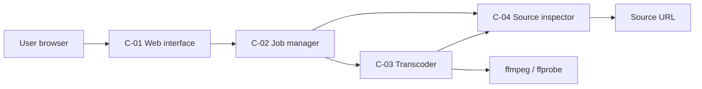

# Minimal architecture

Die vier Komponenten und ihre Verträge stehen in eigenen Dokumenten:

| ID | Komponente | Dokument |
| --- | --- | --- |
| C-01 | Web-Schnittstelle | [[web_interface]] |
| C-02 | Job-Manager | [[job_manager]] |
| C-03 | Transcoder | [[transcoder]] |
| C-04 | Quellenprüfung | [[source_inspector]] |

Dependencies: C-01 → C-02; C-02 → C-03 and C-04; C-03 → C-04. There is no cycle.

## Public interface

- `GET /` form, `POST /jobs` submission, `GET /jobs/<id>` page, `GET /jobs/<id>/status` JSON,
  `GET /jobs/<id>/result.mp4`, `GET /healthz`.
- Entrypoint: `./modernize43` with `--host` (default `127.0.0.1`), `--port` (default `8080`),
  `--allow-private-hosts`, `--retention-minutes` (default 60).

## Source of truth

The requirements in `REQUIREMENTS.md` are normative. The filter graph, class names and file layout
are implementation choices as long as the observable contract above holds. The oracle runs the
generated tree in place and treats the built `./modernize43` binary as the only entrypoint.

## Environment

Go standard library only, built as a single static binary; `ffmpeg` and `ffprobe` must be on
`PATH`. Results live under the
system temporary directory. No database, no external service, no credentials.
