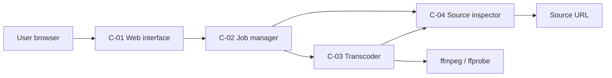

# Minimal architecture

- **C-01 Web interface** — a Python standard-library HTTP server (no third-party packages) serving
  the form, the job page, the status JSON, the MP4 download with single-range support and a health
  endpoint. It owns URL input display and error rendering.
- **C-02 Job manager** — an in-memory job registry with a single worker thread and a FIFO queue. It
  creates a per-job temporary directory, moves a job through `queued` → `running` →
  `done`/`error`, enforces the 180-second budget, and deletes results after the retention time.
- **C-03 Transcoder** — builds and runs the `ffmpeg` command: deinterlace when the source is
  interlaced, apply the detected border crop, cover-scale and blur the background, scale the
  foreground to height 1080 with Lanczos and mild contrast-adaptive sharpening, overlay it centred,
  tag BT.709, encode H.264 CRF 20 with `yuv420p` and faststart, cap at 30 seconds, and encode audio
  as AAC 192 kbit/s stereo. It is the only component that knows the filter graph.
- **C-04 Source inspector** — validates and normalizes the submitted URL (scheme, host, no private
  targets by default), probes with `ffprobe`, detects black borders with `cropdetect` on a short
  sample, derives the cropped display aspect ratio, field order, audio presence and duration, and
  turns tool errors into readable messages.

Dependencies: C-01 → C-02; C-02 → C-03 and C-04; C-03 → C-04. There is no cycle.

## Public interface

- `GET /` form, `POST /jobs` submission, `GET /jobs/<id>` page, `GET /jobs/<id>/status` JSON,
  `GET /jobs/<id>/result.mp4`, `GET /healthz`.
- Entrypoint: `python3 -m modernize43` with `--host` (default `127.0.0.1`), `--port` (default
  `8080`), `--allow-private-hosts`, `--retention-minutes` (default 60).

## Source of truth

The requirements in `REQUIREMENTS.md` are normative. The filter graph, class names and file layout
are implementation choices as long as the observable contract above holds. The oracle runs the
generated tree in place and treats `python3 -m modernize43` as the only entrypoint.

## Environment

Python 3.11+ standard library only; `ffmpeg` and `ffprobe` must be on `PATH`. Results live under the
system temporary directory. No database, no external service, no credentials.
