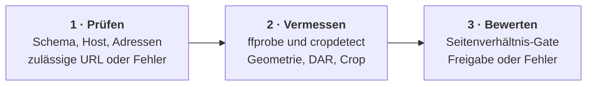

**Komponente:** C-04

Die Quellenprüfung validiert die eingegebene URL, misst Geometrie und schwarze Ränder und
entscheidet, ob die Quelle für den Aufbau geeignet ist.



## Zweck

Genau eine Aufgabe: aus einer URL eine belastbare Beschreibung der Quelle machen und
unzulässige Ziele früh abweisen. Sie entscheidet über Zulässigkeit, nicht über Bildaufbau,
und sie startet keine Transkodierung.

## Schnittstelle

```text
ValidateURL(raw, allowPrivate) -> url | Fehler
Probe(url)                     -> {width, height, sar, dar, crop, fps, has_audio, duration} | Fehler
```

Die zurückgegebene `dar` bezieht sich immer auf das gecroppte Bild. Fehler nennen das
Problem in einem Satz und werden von der Web-Schnittstelle als `400` oder als Jobfehler
ausgegeben.

## Ablauf

| Schritt | Aktion | Ergebnis |
| --- | --- | --- |
| 1 | Schema, Host und aufgelöste Adressen prüfen | zulässige URL oder Fehler |
| 2 | Streams, DAR und Ränder messen | Geometrie inklusive Crop |
| 3 | Seitenverhältnis gegen 16:9 prüfen | Freigabe oder Fehler |

## Regeln

| ID | Regel |
| --- | --- |
| SRC-01 | Nur absolute `http`- und `https`-URLs sind zulässig; Loopback-, private, Link-Local- und unspezifizierte Ziele werden ohne Opt-in abgelehnt. |
| SRC-02 | Zulässig ist nur eine gecroppte Anzeigebreite unterhalb von 16:9 minus 1 % Toleranz; breitere Quellen enden mit einer Meldung, die `aspect ratio` enthält. |
| SRC-03 | Schwarze Ränder werden auf höchstens fünf Sekunden Probe gemessen und vor dem Skalieren entfernt, begrenzt auf 20 % je Seite; ohne Befund bleibt das Bild unverändert. |

## Links

- [[COMPONENTS]] — Komponentenindex
- [[ARCHITECTURE]] — öffentlicher Fluss und Abhängigkeiten
- [[transcoder]] — übernimmt die gelieferte Geometrie
