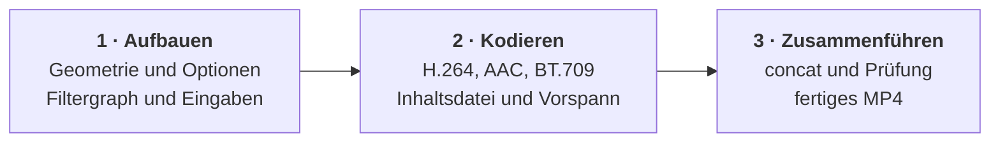

**Komponente:** C-03

Der Transcoder erzeugt aus der geprüften Quelle das fertige 16:9-MP4 mit Blur-Hintergrund,
scharfem Vordergrund, optionalem Logo und optionalem Vorspann.



## Zweck

Genau eine Aufgabe: den in der Spezifikation festgelegten Bildaufbau und die Kodierparameter
in ffmpeg-Aufrufe übersetzen und ausführen. Sie entscheidet nicht, ob eine Quelle zulässig ist
— sie erhält Geometrie und Crop von der Quellenprüfung — und sie verwaltet keine Jobs.

## Schnittstelle

```text
Transcode(sourceURL, outputPath, info, seconds, logo, introURL) -> outputPath | Fehler
```

`info` enthält die von der Quellenprüfung ermittelte Anzeigebreite, SAR, Crop und Framerate.
Ein Fehler enthält die letzte nicht-leere Werkzeugzeile; die Komponente schreibt nie eine
Teilausgabe an den Zielpfad.

## Ablauf

| Schritt | Aktion | Ergebnis |
| --- | --- | --- |
| 1 | Crop, Skalierung und Overlays aus der Geometrie ableiten | Filtergraph und Eingabeliste |
| 2 | Vordergrund, Hintergrund und Logo kodieren, Audio normalisieren | Inhalts-MP4 |
| 3 | Bei Vorspann normalisieren und per concat verbinden | fertiges MP4 |

## Regeln

| ID | Regel |
| --- | --- |
| TRC-01 | Das Ergebnis ist H.264 mit `yuv420p`, exakt 1920×1080, SAR 1:1, BT.709-Tags und `moov` vor `mdat`. |
| TRC-02 | Der Vordergrund wird aus der gecroppten Anzeigebreite auf Höhe 1080 skaliert und zentriert; der Hintergrund wird beschnitten, nie verzerrt, weichgezeichnet und leicht abgedunkelt. |
| TRC-03 | Die Inhaltsdauer entspricht `seconds`; ein Vorspann wird vollständig davorgesetzt, und stummes Material erhält bei Vorspann eine stille Tonspur. |
| TRC-04 | Ein Logo wird nur aus dem mitgelieferten Asset gezeichnet, im 4:3-Bereich oben links, mit 16 % der Vordergrundbreite; ohne Auswahl bleibt das Bild unverändert. |

## Links

- [[COMPONENTS]] — Komponentenindex
- [[ARCHITECTURE]] — öffentlicher Fluss und Abhängigkeiten
- [[source_inspector]] — liefert die Geometrie
