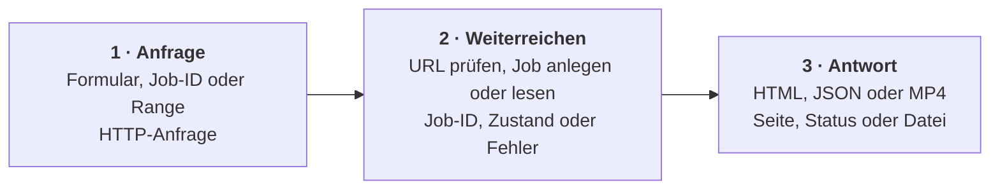

**Komponente:** C-01

Die Web-Schnittstelle stellt Formular, Jobseite, Status-JSON und Ergebnis-Download über HTTP bereit und macht den Jobzustand für den Nutzer sichtbar.



## Zweck

Genau eine Aufgabe: den öffentlichen HTTP-Vertrag bedienen. Sie entscheidet nichts über
Medienverarbeitung — sie validiert Formulareingaben, reicht sie an Job-Manager und
Quellenprüfung weiter und rendert deren Ergebnis. Sie kennt weder Filtergraphen noch
ffmpeg-Aufrufe.

## Schnittstelle

```text
GET  /                      -> HTML-Formular (url, source, logo, intro, seconds)
POST /jobs                  -> 303 /jobs/<id> | 400 mit lesbarem Fehler
GET  /jobs/<id>             -> HTML-Jobseite | 404
GET  /jobs/<id>/status      -> application/json {state, message?, result_url?} | 404
GET  /jobs/<id>/result.mp4  -> 200 oder 206 video/mp4 | 409 | 404
GET  /healthz               -> 200 "ok"
```

Erfolg und Fehler sind getrennt: fehlerhafte Eingaben beantwortet die Komponente mit `400`
und einem Text, der das Problem benennt; unbekannte Jobs mit `404`; ein noch nicht fertiges
Ergebnis mit `409`.

## Ablauf

| Schritt | Aktion | Ergebnis |
| --- | --- | --- |
| 1 | Formular anzeigen und Felder übernehmen | normalisierte Eingabe |
| 2 | Quelle und Optionen prüfen, Job anlegen | Job-ID oder 400 |
| 3 | Jobseite, Status oder Ergebnis ausliefern | HTML, JSON oder MP4 |

## Regeln

| ID | Regel |
| --- | --- |
| WEB-01 | Das Formular enthält `url`, `source`, `logo`, `intro` und `seconds`; fehlende oder unbekannte Werte werden mit `400` abgelehnt, nie stillschweigend ersetzt. |
| WEB-02 | Jobseite, Status und Download folgen der Semantik `303` nach dem Anlegen, `404` für unbekannte Jobs, `409` vor Fertigstellung, `200`/`206` für das Ergebnis inklusive `Content-Disposition`. |
| WEB-03 | Ein Ergebnis-Download unterstützt genau eine Byte-Range mit `206` und korrektem `Content-Range`; ungültige Ranges beantwortet er mit `416`. |

## Links

- [[COMPONENTS]] — Komponentenindex
- [[ARCHITECTURE]] — öffentlicher Fluss und Abhängigkeiten
- [[job_manager]] — nimmt angelegte Jobs entgegen
